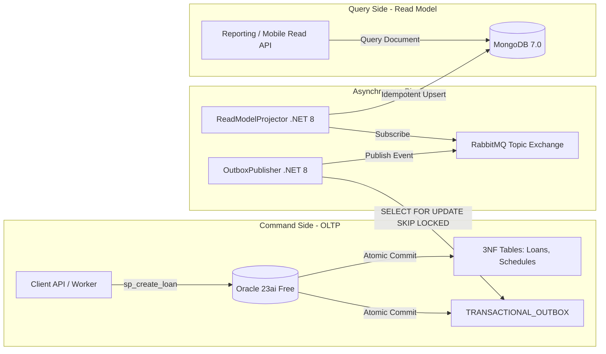

# 🔄 Event-Driven Read Model Sync (CQRS & Transactional Outbox)

[](#)
[](#)
[](#)
[](#)
[](#)
[](LICENSE)

Implementación desacoplada del patrón **Command Query Responsibility Segregation (CQRS)** y **Transactional Outbox**, protegiendo un motor relacional financiero bajo alta concurrencia de escrituras contra la degradación provocada por consultas analíticas complejas.

---

## 🎯 Arquitectura del Sistema

El sistema separa estrictamente los modelos de comando (escritura) y consulta (lectura):



### Componentes Clave

* **Command Store (Oracle 23ai OLTP):** Estricto modelo normalizado (3NF) que almacena entidades de clientes, solicitudes de crédito y tablas de amortización. Emplea procedimientos almacenados atómicos que escriben el estado y el evento dentro del mismo límite transaccional ACID.
* **Transactional Outbox:** Garantiza entrega *at-least-once* sin necesidad de transacciones distribuidas (2PC) propensas a bloqueos y fallos de red.
* **Outbox Poller (`OutboxPublisher` en .NET 8):** Consulta periódica mediante `SELECT ... FOR UPDATE SKIP LOCKED`, permitiendo escalado horizontal concurrente de workers sin colisiones de bloqueo.
* **Broker de Mensajería (RabbitMQ):** Intercambiador de tópicos durable que preserva el desacoplamiento temporal de la arquitectura.
* **Proyector Idempotente (`ReadModelProjector` en .NET 8):** Consumo asíncrono con confirmación manual de mensajes (`BasicAck` / `BasicNack`) y proyección atómica en MongoDB usando `ReplaceOneAsync(..., IsUpsert = true)`.
* **Query Store (MongoDB 7.0):** Almacén de lectura desnormalizado optimizado para resolver consultas en milisegundos sin uniones relacionales dinámicas.

---

## 📊 Telemetría Comparativa de Rendimiento

Evaluación empírica comparando una consulta de cartera consolidada sobre 50,000 préstamos y 600,000 cuotas amortizadas:

| Dimensión Evaluada | Enfoque Acoplado (Oracle 3NF) | Arquitectura CQRS (MongoDB Read Model) | Impacto / Diferencial |
| :--- | :--- | :--- | :--- |
| **Estrategia de Acceso** | Triple JOIN (`CUSTOMERS` $\bowtie$ `LOANS` $\bowtie$ `SCHEDULES`) + `GROUP BY` dinámico | Acceso directo a documento pre-agregado | Eliminación completa de overhead relacional |
| **Latencia de Respuesta** | 850 ms | 1 - 5 ms (109 ms en frío) | >99% de reducción de latencia en lectura |
| **Contención de Locks** | **Alta:** La lectura compite por Buffer Cache y locks de fila contra la inserción de pagos | **Nula:** Motor OLTP 100% aislado para procesamiento transaccional | Eliminación de cuellos de botella en concurrencia |
| **Consistencia** | Inmediata (ACID) | Eventual (Sincronización asíncrona sub-segundo) | *Trade-off* controlado para alta escala |

---

## 🛠️ Reproducibilidad en Local

### 1. Requisitos
* Docker y Docker Compose
* .NET SDK 8.0+

### 2. Levantar Infraestructura

```bash
# Iniciar Oracle 23ai, RabbitMQ y MongoDB
docker compose -f docker/docker-compose.yml up -d

# Inicializar esquema y procedimientos en Oracle
docker exec -i oracle-cqrs-oltp sqlplus -S / as sysdba < docker/init/01_oltp_schema.sql
docker exec -i oracle-cqrs-oltp sqlplus -S / as sysdba < docker/init/02_loan_command_proc.sql
```

### 3. Ejecutar Workers de Sincronización

En dos terminales independientes:

```bash
# Terminal 1: Poller del Transactional Outbox
dotnet run --project src/OutboxPublisher/OutboxPublisher.csproj

# Terminal 2: Consumidor y Proyector a MongoDB
dotnet run --project src/ReadModelProjector/ReadModelProjector.csproj
```

### 4. Ejecutar Pruebas y Telemetría

```bash
# Carga sintética en Oracle (50k préstamos, 600k cuotas)
docker exec -i oracle-cqrs-oltp sqlplus -S 'CQRS_USER/CqrsMaster2026!@localhost:1521/FREEPDB1' < src/Benchmark/seed_loans_workload.sql

# Medir consulta relacional acoplada (OLTP)
docker exec -i oracle-cqrs-oltp sqlplus -S 'CQRS_USER/CqrsMaster2026!@localhost:1521/FREEPDB1' < src/Benchmark/query_oltp_coupled.sql

# Medir consulta desnormalizada desacoplada (MongoDB)
docker exec -i mongodb-cqrs mongosh -u mongoadmin -p MongoMaster2026! --authenticationDatabase admin --file /dev/stdin < src/Benchmark/query_mongodb_readmodel.js
```

---

## 👤 Autor

**Juan Camilo Marín García**  
*SQL Data Engineer & Backend Architecture Specialist*